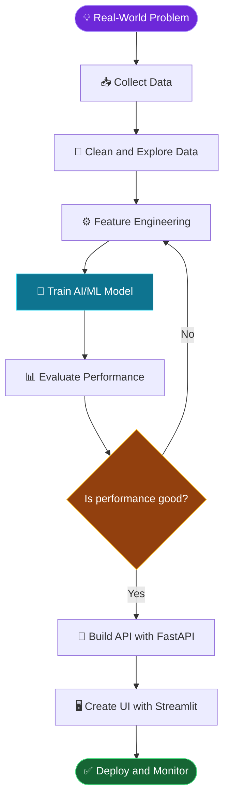

## 🧭 Explore My Profile

[👨‍💻 About Me](#-about-me) • [🛠️ Skills](#-my-ai-ml-toolkit) • [🚀 Projects](#-featured-projects) • [🔄 Workflow](#-how-i-build-ai-applications) • [📊 Stats](#-github-dashboard) • [📬 Contact](#-lets-connect)

---

## 👨‍💻 About Me

🎓 B.Tech Graduate in Computer Science Engineering  
**Sri Venkateswara University College of Engineering (SVUCE)**

I enjoy turning data and ideas into practical applications using Machine Learning, Deep Learning, and Generative AI.

### 🎯 What I Do

- 🤖 Build machine learning models and AI-powered applications.
- 🔎 Explore NLP, LLMs, RAG, embeddings, and information retrieval.
- 🌐 Develop APIs and user interfaces with FastAPI and Streamlit.
- 📈 Analyze data and evaluate model performance.
- 🤝 Seek entry-level AI/ML opportunities and collaborative projects.

---

## 🛠️ My AI/ML Toolkit

| Area | Technologies |
|---|---|
| 💻 Programming | Python, SQL |
| 📊 Data Analysis | NumPy, Pandas, Matplotlib, Seaborn |
| 🤖 Machine Learning | Scikit-learn, XGBoost, Joblib |
| 🧠 Deep Learning | TensorFlow, PyTorch, Neural Networks |
| ✨ Generative AI | NLP, LLMs, RAG, Gemini API, Prompt Engineering |
| 🔍 Retrieval Systems | FAISS, BM25, Embeddings, Hybrid Search, Reranking |
| 🌐 App Development | FastAPI, Streamlit, REST APIs |
| 🗄️ Databases & Tools | MySQL, SQLAlchemy, Pydantic, Git, GitHub |

<b>🔍 Explore my technical skills</b>

**Programming and data:** Python, SQL, NumPy, Pandas, Matplotlib, Seaborn.

**Machine Learning:** data preprocessing, feature engineering, model training, evaluation, Scikit-learn, XGBoost.

**AI and retrieval:** neural networks, NLP, LLMs, RAG, embeddings, FAISS, BM25, hybrid retrieval, reranking, Gemini API.

**Deployment:** FastAPI, Streamlit, REST APIs, Joblib.

**Development tools:** MySQL, SQLAlchemy ORM, Pydantic, Git, GitHub, Jupyter Notebook.

---

## 🔄 How I Build AI Applications

*Follow the flow from a real-world problem to a working application.*

**In simple terms:** understand the problem → prepare the data → train the model → test the results → deploy the application.

---

## 🚀 Featured Projects

<b>🧠 1. Resume Intelligence — AI-Powered Resume Analysis</b>

Compare resumes with job descriptions, retrieve relevant evidence, and identify matching skills and skill gaps.

**Tech stack:** Python, NLP, RAG, FAISS, BM25, Gemini API, FastAPI, Streamlit.

[📂 View Source Code](https://github.com/naveen057/resume-intelligence) · [🌐 Try Live Demo](https://resume-intelligence-entgyngd5vq2pmrrpzyf84.streamlit.app/)

<b>🛡️ 2. Real-Time Fraud Detection</b>

Machine learning pipeline for identifying potentially fraudulent transactions, with threshold optimization and API-based predictions.

**Tech stack:** Python, Pandas, Scikit-learn, FastAPI, Joblib, Docker.

[📂 View Source Code](https://github.com/naveen057/fraud-detection)

<b>❤️ 3. Heart Disease Risk Prediction</b>

Machine learning application that estimates heart disease risk from health-related input data.

**Tech stack:** Python, Pandas, NumPy, Scikit-learn, FastAPI, Joblib.

[📂 View Source Code](https://github.com/naveen057/heart-disease-risk-prediction)

<b>🌐 4. Multi-Source Web Scraping Pipeline</b>

Collect and process information from multiple web sources using a Python-based pipeline.

[📂 View Source Code](https://github.com/naveen057/multi-source-web-scraping-pipeline)

<b>🔧 5. Vehicle Service Management System</b>

Django application for managing customers, mechanics, service requests, repairs, invoices, and feedback.

[📂 View Source Code](https://github.com/naveen057/vehicle-service-management-system)

<b>📊 6. OpenPowerlifting Data Analysis</b>

Explore and analyze powerlifting data using Python and Jupyter Notebook.

[📂 View Source Code](https://github.com/naveen057/openpowerlifting-data-analysis)

---

## 📈 My Learning Journey

### 📚 Currently Exploring

- [ ] Deep Learning with PyTorch
- [ ] Convolutional Neural Networks (CNNs)
- [ ] Transfer learning and model optimization
- [ ] LLMs and advanced RAG applications
- [ ] AI application development and deployment

---

## 📊 GitHub Dashboard

---

## 📬 Let's Connect

### ⭐ Thanks for visiting my profile!

*Keep learning. Keep building. Keep improving.* 🚀

