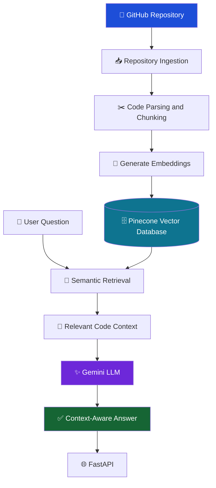
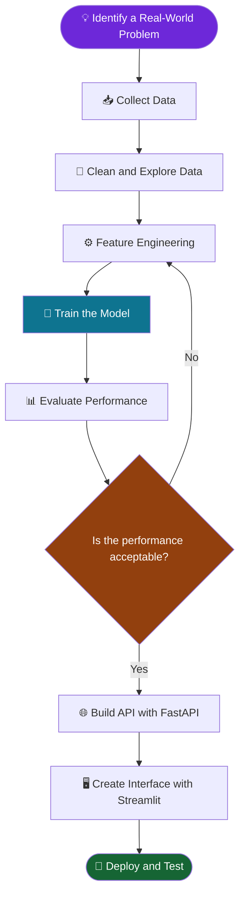

# 👋 Hi, I'm Thura Venkata Naveen

**B.Tech Graduate in Computer Science Engineering**  
Sri Venkateswara University College of Engineering (SVUCE)

I build practical AI applications using Machine Learning, NLP, Generative AI, and Retrieval-Augmented Generation (RAG).

---

## 🧭 Explore My Profile

[👨‍💻 About Me](#-about-me) • [🛠️ Skills](#️-my-ai-ml-toolkit) • [🚀 Projects](#-featured-projects) • [🔄 Workflow](#-how-i-build-ai-applications) • [📊 Stats](#-github-dashboard) • [📬 Contact](#-lets-connect)

---

## 👨‍💻 About Me

- 🎓 B.Tech graduate in Computer Science Engineering from SVUCE.
- 🤖 Interested in Machine Learning, Deep Learning, NLP, and Generative AI.
- 🔎 Exploring LLMs, RAG, vector databases, embeddings, and information retrieval.
- 🌐 Building AI applications using Python, FastAPI, and Streamlit.
- 📊 Practicing data preprocessing, feature engineering, and model evaluation.
- 🎯 Seeking entry-level opportunities in AI/ML, Python Development, and Data Science.

---

## 🛠️ My AI/ML Toolkit

| Category | Technologies |
|---|---|
| 💻 Programming | Python, SQL |
| 📊 Data Analysis | NumPy, Pandas, Matplotlib, Seaborn |
| 🤖 Machine Learning | Scikit-learn, XGBoost, Joblib |
| 🧠 Deep Learning | PyTorch, TensorFlow, Neural Networks |
| ✨ Generative AI | NLP, LLMs, RAG, Gemini API, Prompt Engineering |
| 🔍 Information Retrieval | FAISS, BM25, Embeddings, Hybrid Search, Reranking |
| 🌐 API & Applications | FastAPI, Streamlit, REST APIs |
| 🗄️ Databases | MySQL, Pinecone |
| 🧰 Development Tools | Git, GitHub, Jupyter Notebook, SQLAlchemy, Pydantic |

<b>🔍 Explore my technical skills</b>

**Python and Data:** Python programming, SQL, data manipulation, data visualization, exploratory data analysis.

**Machine Learning:** Data preprocessing, feature engineering, supervised learning, model training, evaluation, classification, XGBoost, Scikit-learn.

**Generative AI:** Natural Language Processing, Large Language Models, RAG pipelines, embeddings, Gemini API, prompt engineering.

**Search and Retrieval:** FAISS, Pinecone, BM25, hybrid retrieval, reciprocal rank fusion, cross-encoder reranking.

**Deployment:** FastAPI, Streamlit, REST API development, Joblib, Docker fundamentals.

**Tools:** Git, GitHub, MySQL, SQLAlchemy, Pydantic, Jupyter Notebook.

---

## ⭐ Major Project — RepoRAG

### 🧠 RepoRAG — AI-Powered Code Intelligence System

**Ask questions about a codebase in natural language.**

### 📌 Problem Statement

Developers, especially beginners, can struggle to understand unfamiliar GitHub repositories. Manually opening files and searching for relevant functions or classes takes time.

### 💡 Solution

RepoRAG is an AI-powered code intelligence system designed to help developers explore repositories by asking questions in plain English. It retrieves relevant code snippets and uses a RAG pipeline to help generate context-aware answers.

### ⚙️ Key Features

- 📂 Ingests source code from GitHub repositories.
- ✂️ Splits code into manageable chunks for retrieval.
- 🧠 Uses embeddings to represent code and support semantic search.
- 🗄️ Stores and searches vector representations using Pinecone.
- 🔎 Retrieves relevant code context for user questions.
- 💬 Uses a Gemini-powered generation step to help answer questions about the codebase.
- 🌐 Uses FastAPI for backend API development.

### 🏗️ System Architecture

### 🛠️ Tech Stack

**Python • FastAPI • RAG • Gemini API • Embeddings • Pinecone • Semantic Search**

### 🎯 Expected Benefits

- Reduces manual code searching.
- Helps developers navigate unfamiliar repositories.
- Makes code exploration more accessible through natural-language questions.

📂 **Repository:** Add your actual RepoRAG repository URL here when available.

---

## 🚀 Featured Projects

<b>⭐ 1. RepoRAG — AI-Powered Code Intelligence System (Major Project)</b>

An AI-powered code intelligence system that helps developers understand unfamiliar GitHub repositories by asking questions in natural language instead of manually searching through multiple files.

**💡 Problem Statement**

Developers often spend considerable time understanding unfamiliar codebases, locating relevant functions, and tracing code across files.

**🚀 Solution**

RepoRAG uses Retrieval-Augmented Generation (RAG) to retrieve relevant code snippets from a GitHub repository and help generate context-aware answers to developers' questions.

**✨ Key Features**
- 📂 GitHub repository ingestion and code processing.
- ✂️ Source-code chunking for efficient retrieval.
- 🧠 Gemini embeddings for representing code.
- 🗄️ Pinecone vector database for storing and retrieving embeddings.
- 🔎 Semantic search to identify relevant code snippets.
- 💬 Gemini-powered answers grounded in retrieved code context.
- 🌐 FastAPI backend for API-based interaction.

**🛠️ Tech Stack**

`Python` · `FastAPI` · `RAG` · `Gemini API` · `Embeddings` · `Pinecone` · `Semantic Search`

**🔄 Workflow**

GitHub Repository → Code Ingestion → Chunking → Embeddings → Pinecone Vector Database → Relevant Code Retrieval → Gemini LLM → Context-Aware Answer

**🎯 Impact**

Designed to reduce manual code exploration and make unfamiliar repositories easier to understand through natural-language questions.

📂 **[View Source Code](REPLACE_WITH_YOUR_REPORAG_REPOSITORY_URL)**

<b>📄 2. Resume Intelligence — AI-Powered Resume Analysis</b>

An AI-powered application that compares resumes with job descriptions, retrieves relevant evidence, and identifies matching skills and potential skill gaps.

**Key Features**
- Resume parsing and text extraction.
- BM25 and FAISS-based retrieval.
- Hybrid search and reranking.
- Evidence-based skill matching.
- Optional Gemini-generated explanations.

**Tech Stack:** Python, NLP, RAG, FAISS, BM25, Gemini API, FastAPI, Streamlit.

[📂 Source Code](https://github.com/naveen057/resume-intelligence) · [🌐 Live Demo](https://resume-intelligence-entgyngd5vq2pmrrpzyf84.streamlit.app/)

<b>🛡️ 3. Real-Time Fraud Detection System</b>

A machine learning application that identifies potentially fraudulent transactions using a trained model and API-based predictions.

**Tech Stack:** Python, Pandas, Scikit-learn, FastAPI, Joblib, Docker.

[📂 Source Code](https://github.com/naveen057/fraud-detection) · [🌐 Live Demo](https://fraud-detection-dz3c.onrender.com/)

<b>❤️ 4. Heart Disease Risk Prediction</b>

A machine learning application that estimates heart disease risk from health-related input features.

**Tech Stack:** Python, Pandas, NumPy, Scikit-learn, FastAPI, Joblib.

[📂 Source Code](https://github.com/naveen057/heart-disease-risk-prediction)

<b>🌐 5. Multi-Source Web Scraping Pipeline</b>

A Python-based pipeline for collecting and processing information from multiple web sources.

[📂 Source Code](https://github.com/naveen057/multi-source-web-scraping-pipeline)

<b>🔧 6. Vehicle Service Management System</b>

A Django application for managing customers, mechanics, service requests, repairs, invoices, and feedback.

[📂 Source Code](https://github.com/naveen057/vehicle-service-management-system)

<b>📊 7. OpenPowerlifting Data Analysis</b>

A data analysis project exploring powerlifting datasets using Python and Jupyter Notebook.

[📂 Source Code](https://github.com/naveen057/openpowerlifting-data-analysis)

---

## 🔄 How I Build AI Applications

**My approach:** Understand the problem → Prepare the data → Build the solution → Evaluate the results → Develop the application → Deploy and improve.

---

## 📚 My Learning Journey

### 🎯 Currently Exploring

- [ ] Deep Learning with PyTorch
- [ ] Neural Networks and Backpropagation
- [ ] Convolutional Neural Networks (CNNs)
- [ ] Transfer Learning and Model Optimization
- [ ] Advanced RAG and LLM Applications
- [ ] AI Application Deployment

---

## 📊 GitHub Dashboard

---

## 📬 Let's Connect

I'm interested in entry-level AI/ML opportunities, Python development, and projects involving Generative AI.

### ⭐ Thanks for visiting my profile! 

*Keep learning. Keep building. Keep improving.* 🚀

