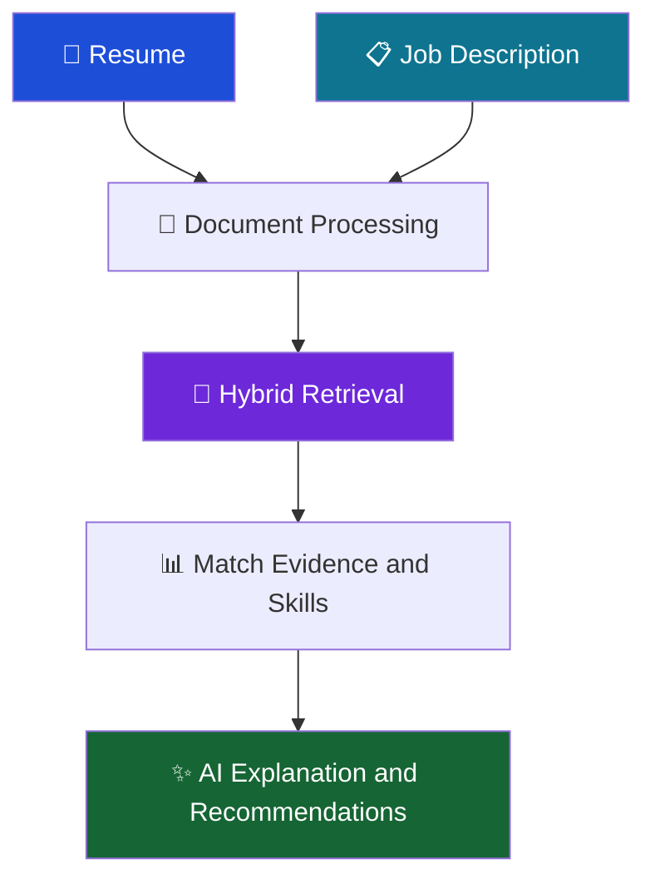
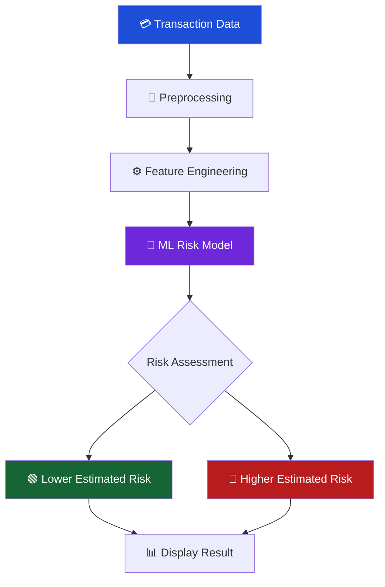
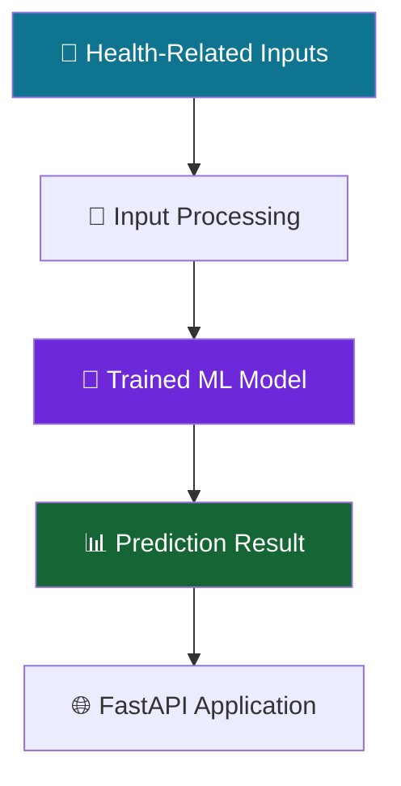
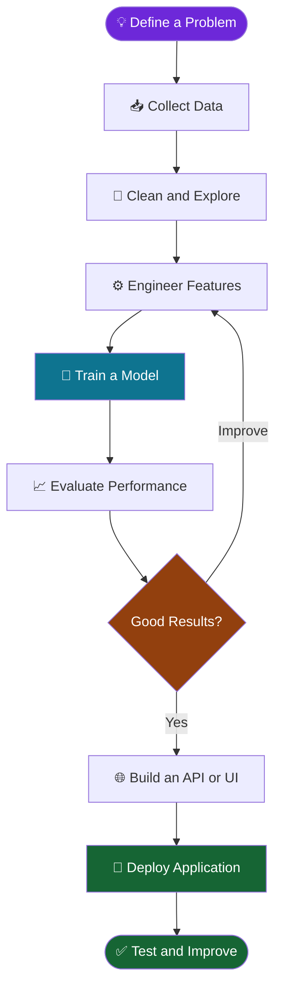

# 👋 Hi, I'm Thura Venkata Naveen

🎓 **B.Tech Graduate in Computer Science Engineering**  
Sri Venkateswara University College of Engineering (SVUCE)

---

## 🧭 Explore My Profile

[🙋 About](#-about-me) · [🛠️ Skills](#-my-technical-toolkit) · [🚀 Projects](#-featured-projects) · [🔄 Workflow](#-how-i-build-ai-applications) · [📊 Stats](#-github-dashboard) · [📬 Contact](#-lets-connect)

## 🙋 About Me

I'm passionate about building practical AI applications, solving real-world problems with data, and exploring Machine Learning, Deep Learning, and Generative AI.

- 🔭 Building AI/ML applications and intelligent solutions.
- 🌱 Exploring Deep Learning, PyTorch, LLMs, and RAG.
- 🧠 Interested in Machine Learning, NLP, and Generative AI.
- 💻 Developing applications using Python, FastAPI, and Streamlit.
- 🎯 Seeking entry-level opportunities in AI/ML, Data Science, and Python Development.
- 🤝 Open to collaboration, new challenges, and continuous learning.

---

## 🛠️ My Technical Toolkit

### 💻 Programming and Data

### 🤖 Machine Learning and AI

### ✨ Generative AI and Retrieval

### 🌐 Application Development

<b>🔎 View skills by category</b>

| Category | Skills |
|---|---|
| Programming | Python, SQL |
| Data Analysis | NumPy, Pandas, Matplotlib, Seaborn |
| Machine Learning | Scikit-learn, XGBoost, Joblib, feature engineering, model evaluation |
| Deep Learning | TensorFlow, PyTorch, neural networks |
| Generative AI | NLP, LLMs, RAG, prompt engineering, Google Gemini API |
| Information Retrieval | FAISS, BM25, embeddings, hybrid search, reranking |
| APIs and Frameworks | FastAPI, Streamlit, REST APIs |
| Databases and Tools | MySQL, SQLAlchemy ORM, Pydantic, Git, GitHub, Jupyter Notebook |

---

## 🚀 Featured Projects

*Explore the projects, understand the problem each one addresses, and open the live applications where available.*

### 🧠 1. Resume Intelligence

**Problem:** Comparing resumes with job descriptions manually can be time-consuming.

**Solution:** An AI-powered application that compares resumes with job requirements, retrieves relevant evidence, highlights matching skills, and identifies skill gaps.

**Tech stack:** Python · NLP · RAG · FAISS · BM25 · Gemini API · FastAPI · Streamlit

<b>🔍 How it works</b>

### 🛡️ 2. Intelligent Transaction Risk Detection

**Problem:** Suspicious financial transactions need to be identified without flagging every legitimate payment.

**Solution:** An end-to-end ML application that evaluates transaction information, estimates fraud risk, and provides a prediction through a web interface and API.

**Tech stack:** Python · Pandas · Scikit-learn · XGBoost · FastAPI · Joblib · Docker

<b>🔍 How it works</b>

*Note: This project uses synthetic transaction data. Predictions are estimates for demonstration, not definitive fraud determinations.*

### ❤️ 3. Heart Disease Risk Prediction

**Problem:** Understanding patterns in health-related data is an important machine learning application.

**Solution:** A web application that processes health-related inputs and generates a model-based heart disease risk prediction.

**Tech stack:** Python · Pandas · NumPy · Scikit-learn · FastAPI · Joblib

<b>🔍 How it works</b>

*Note: The project is for educational purposes, not medical diagnosis. A verified public demo link is not currently listed.*

### 🌐 4. Multi-Source Web Scraping Pipeline

**Goal:** Collect data from multiple public web sources and consolidate it into a consistent dataset.

**Highlights:** Web scraping · pagination · data cleaning · schema validation · duplicate detection · CSV/JSON exports.

### 🔧 5. Vehicle Service Management System

**Goal:** Manage vehicle service operations through a Django application.

**Highlights:** Customer management · mechanics · service requests · repairs · invoices · feedback.

### 📊 6. OpenPowerlifting Data Analysis

**Goal:** Explore a powerlifting dataset using Python-based data analysis.

**Highlights:** Jupyter Notebook · data exploration · statistical analysis · visualizations.

---

## 🔄 How I Build AI Applications

---

## 📚 My Learning Journey

- [ ] Deep Learning with PyTorch
- [ ] Convolutional Neural Networks (CNNs)
- [ ] Transfer learning and model optimization
- [ ] Advanced LLM and RAG applications
- [ ] Building and deploying AI applications

---

## 📊 GitHub Dashboard

---

## 🏆 What I Bring

| 🧠 Problem Solving | 🛠️ Practical Development | 📈 Continuous Learning |
|---|---|---|
| Data-driven thinking | End-to-end project experience | Exploring modern AI tools |
| ML model evaluation | APIs and web applications | Improving technical skills |

---

## 🤝 Let's Connect

I'm open to entry-level opportunities, AI/ML projects, and meaningful collaborations.

**⭐ Thanks for visiting my profile!**

*Keep learning. Keep building. Keep improving.* 🚀

