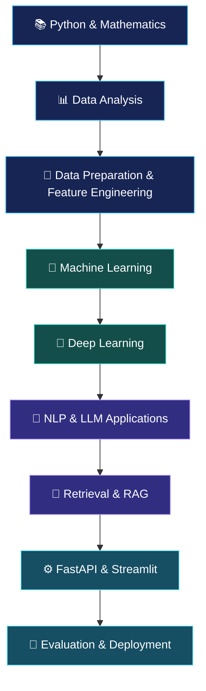
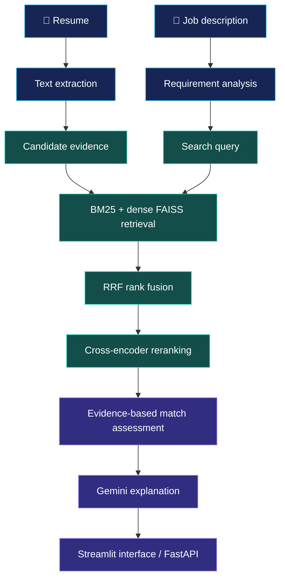
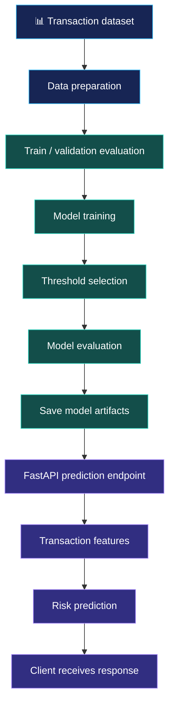
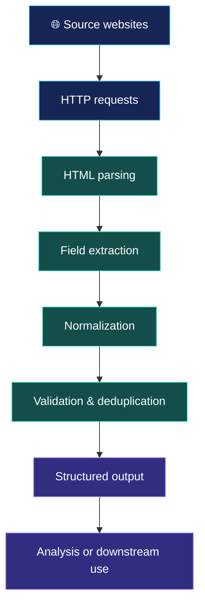
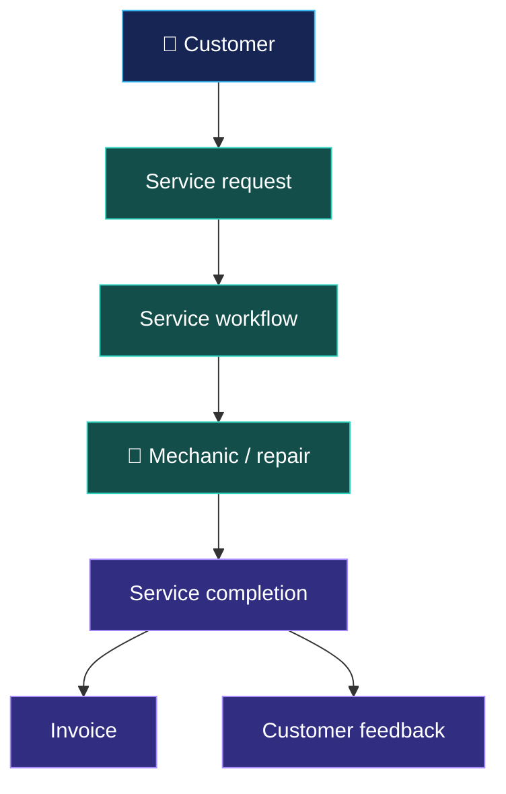
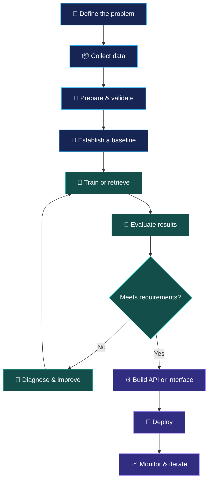

# 🌌 Thura Venkata Naveen | AI/ML Engineer

  

  

  
  
  
  

---

## ✨ About Me

Hi! I'm **Thura Venkata Naveen**, a Computer Science Engineering graduate from Sri Venkateswara University College of Engineering (SVUCE), 2026.

I'm focused on building practical AI and machine learning applications that connect data, intelligent models, retrieval systems, and production-ready APIs.

- 🤖 Exploring machine learning, deep learning, NLP, and applied LLMs.
- 🔎 Building retrieval-augmented applications using embeddings, FAISS, BM25, hybrid search, and reranking.
- 📊 Working with data analysis, model evaluation, feature engineering, and statistical methods.
- ⚙️ Developing APIs and interfaces with FastAPI and Streamlit.
- 🧠 Currently strengthening my deep learning skills with PyTorch.
- 🎯 Seeking entry-level opportunities in AI/ML engineering, data science, and Python development.

> My goal: build AI systems that are understandable, measurable, useful, and deployable.

## 🧭 My AI Engineering Journey

## 🛠️ Technical Skills

  

| Area | Technologies and concepts |
|---|---|
| Programming | Python, SQL |
| Data analysis | NumPy, Pandas, Matplotlib, Seaborn |
| Machine learning | Scikit-learn, XGBoost, feature engineering, model evaluation, hyperparameter tuning |
| Deep learning | Neural networks, CNN fundamentals, PyTorch learning, TensorFlow |
| NLP & LLMs | Embeddings, prompt engineering, Google Gemini API, RAG |
| Information retrieval | FAISS, BM25, hybrid search, Reciprocal Rank Fusion (RRF), cross-encoder reranking |
| Backend development | FastAPI, REST APIs, Pydantic, SQLAlchemy ORM |
| Databases | MySQL |
| Applications | Streamlit |
| Tools | Git, GitHub, Joblib, Docker |

## 🚀 Featured Projects

Projects are organized by the engineering problem they solve. Each project links to its source repository; a live demo is shown only where a public URL has been verified or supplied and clearly identified.

### 01 · Resume Intelligence

  
  
  

**Problem:** Comparing resumes with job descriptions can be time-consuming, and simple keyword matching can miss relevant experience.

**Solution:** A resume-to-job matching application that combines lexical and semantic retrieval, rank fusion, reranking, and AI-generated explanations.

**Project journey**

**What it demonstrates**
- Combining keyword and semantic retrieval.
- Improving ranking through fusion and reranking.
- Separating evidence-based matching from generated explanations.
- Connecting an AI workflow to a user-facing application and API.

  

*Live demo: a previously supplied Streamlit URL has not been independently verified, so it is intentionally not presented here as a confirmed live demo.*

### 02 · Fraud Detection API

  
  
  

**Problem:** Financial transaction systems need a way to identify potentially risky transactions from transaction features.

**Solution:** A machine learning project that evaluates transaction risk and exposes predictions through an API.

**Project journey**

**What it demonstrates**
- Transaction classification and model evaluation.
- Decision-threshold selection.
- Serving predictions through a REST API.
- Packaging model artifacts for application use.

  
  

### 03 · Heart Disease Risk Prediction

  
  

**Problem:** Understand how structured health-related features can be used in a classification workflow.

**Project journey**

**What it demonstrates**
- Exploratory data analysis.
- Classification workflow design.
- Model evaluation and interpretation.

  

*This is an educational machine learning project, not a clinical diagnostic tool. No live demo is listed.*

### 04 · Multi-source Web Scraping Pipeline

  
  

**Problem:** Data from different websites can have inconsistent structures and require repeated manual collection.

**Project journey**

**What it demonstrates**
- Extracting structured data from web pages.
- Cleaning and standardizing records.
- Organizing repeatable data collection workflows.

  

### 05 · Vehicle Service Management System

  
  

**Problem:** Vehicle servicing involves customers, mechanics, service requests, repairs, invoices, and feedback.

**Project journey**

**What it demonstrates**
- Web application development with Django.
- Managing related business entities and workflows.
- Organizing service requests, repairs, invoices, and feedback.

  

### 06 · OpenPowerlifting Data Analysis

  
  

**Project journey**

**What it demonstrates**
- Working with a real-world dataset.
- Cleaning, analyzing, and comparing structured data.
- Communicating findings through visualizations.

  

## 🏗️ How I Approach AI Applications

My focus is on more than obtaining a model prediction. I aim to understand the data, evaluate performance, make results accessible, and communicate limitations clearly.

## 📚 Current Learning Focus

- **Deep learning:** tensors, autograd, forward propagation, backpropagation, optimizers, CNNs, regularization, and transfer learning.
- **Model development:** validation, error analysis, hyperparameter tuning, and reproducible experiments.
- **LLM applications:** retrieval quality, embeddings, reranking, grounded generation, and evaluation.
- **Deployment:** API design, input validation, testing, and containerization.

## 📊 GitHub Activity

  
  

  

*Stats and language cards are provided by external services and may occasionally be unavailable. Language percentages reflect repository contents, not a direct measure of expertise.*

## 🤝 Let's Connect

I'm interested in entry-level opportunities, practical AI/ML projects, and collaborating with engineers who enjoy building useful products.

  
  
  
  

  

  <i>Learn continuously. Build thoughtfully. Deploy responsibly. 🌌</i>

